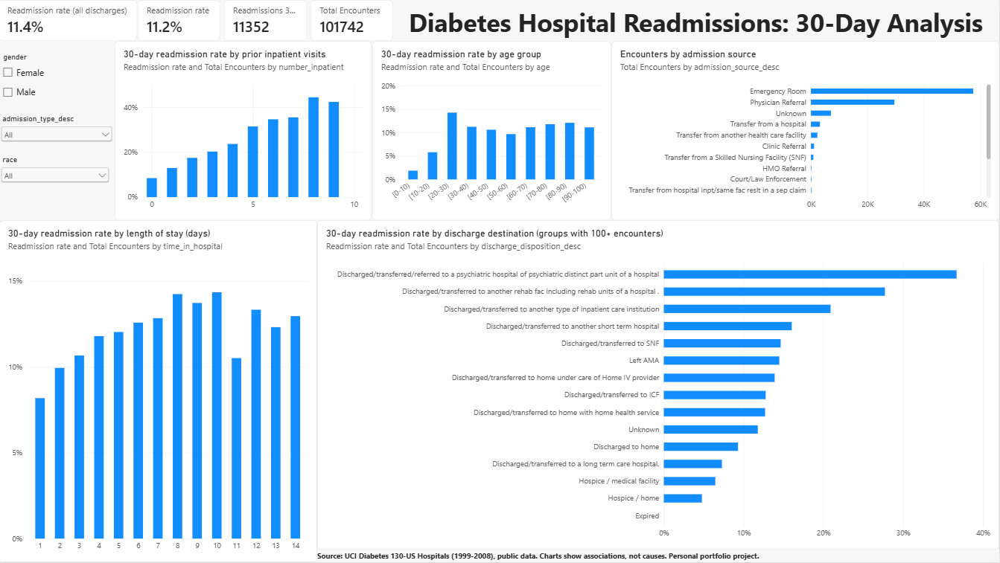
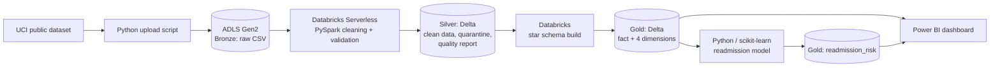
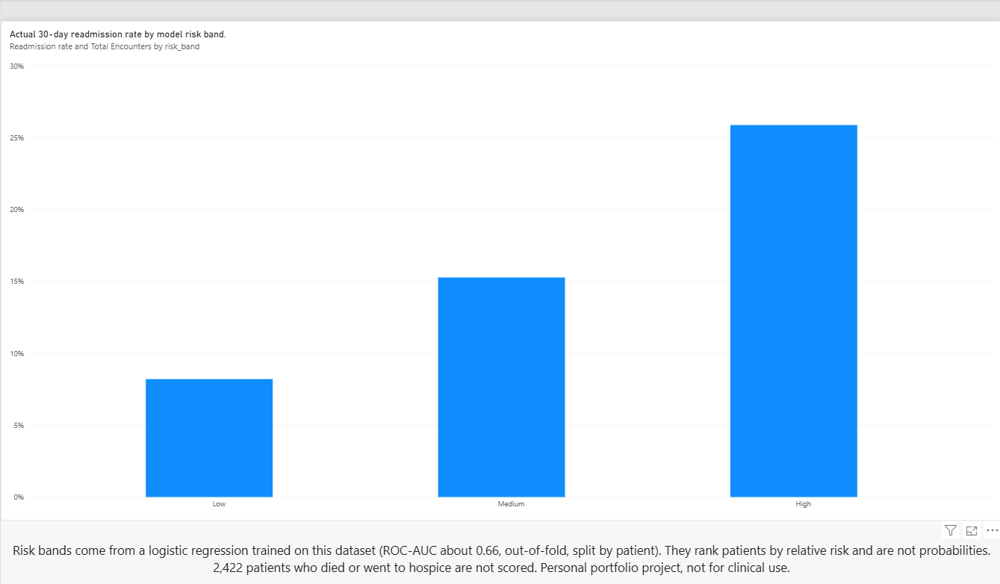

# Cloud Healthcare Data Engineering & AI Analytics Pipeline

> **Personal portfolio project.** Built to get hands-on with Azure, Databricks, PySpark and Delta Lake using **public** healthcare data. No employer or patient-identifiable data is used. Not validated for clinical use.

An end-to-end data platform on Azure: raw hospital records go in, and a governed Bronze/Silver/Gold lakehouse, a Power BI dashboard and a 30-day readmission risk model come out.



## Business problem

Hospital readmissions within 30 days are costly and often point to gaps in care. This project asks: **can we build a reliable, well-checked data pipeline over hospital encounter data, show where readmissions concentrate, and rank patients by relative risk at discharge?**

## Dataset

[Diabetes 130-US Hospitals for Years 1999-2008](https://archive.ics.uci.edu/dataset/296/diabetes-130-us-hospitals-for-years-1999-2008) (UCI Machine Learning Repository; Strack et al., 2014).

- 101,766 encounters, 50 columns, 130 US hospitals
- Two files: `diabetic_data.csv` and `IDS_mapping.csv` (code lookups)
- Raw data is **not** stored in this repo. Download it from the link above.

## Architecture



| Layer | Contents | Format |
|-------|----------|--------|
| Bronze | Raw files, never modified | CSV |
| Silver | `diabetic_encounters` (101,742 rows), `quarantine_invalid_gender` (3), `data_quality_report` (22 rules) | Delta |
| Gold | `fact_encounter`, `dim_admission_type`, `dim_discharge_disposition`, `dim_admission_source`, `dim_age_group`, `readmission_risk` | Delta |

## Tech stack

Python, SQL, PySpark, Azure Data Lake Storage Gen2, Azure Databricks (Serverless), Unity Catalog (storage credential + external location for governed access), Delta Lake, Power BI, scikit-learn, Git/GitHub.

## What the pipeline does

**Bronze: ingestion.** A Python script uploads the raw files to ADLS Gen2 using the Data Lake SDK. Credentials live in a local `.env` file that is git-ignored.

**Silver: cleaning and validation.**
- Placeholder `?` values converted to nulls (string columns only)
- Missing values handled **by cause**, not with one blanket rule: `weight` dropped (mostly missing), `medical_specialty` / `payer_code` / `race` labelled `Unknown`, `diag_2` / `diag_3` labelled `None` (no second or third diagnosis), rows with no primary diagnosis removed
- Invalid-gender rows moved to a **quarantine table** rather than silently deleted
- A **22-rule data-quality report** (pass/fail per rule) saved alongside the data
- 101,766 raw rows became 101,742 Silver rows; the 24 removed rows are accounted for (3 quarantined, the rest missing a primary diagnosis)

**Gold: analytics model.** A star schema with `fact_encounter` (one row per encounter, 23 columns) and four dimensions. The target `readmitted_30d` is derived from the source `readmitted` field. Encounters where the patient died or went to hospice are **flagged** `not_at_risk_of_readmission` rather than deleted, so each report can choose whether to include them.

**Delta Lake.** All Silver and Gold tables are Delta. Hands-on checks include the transaction log, schema enforcement (a mismatched write is rejected), schema evolution with `mergeSchema`, versioning and time travel, and the retention window.

## Dashboard

Power BI reads the Gold Delta tables directly from ADLS Gen2 (no cluster running), with DAX measures for encounters, 30-day readmissions and readmission rate (including a rate that excludes patients not at risk).



The `.pbix` file is in [`powerbi/`](powerbi/).

## Machine learning: 30-day readmission risk

Full write-up: [`ml_model.md`](ml_model.md).

| | |
|---|---|
| Population | 99,320 encounters, 69,979 patients; 11.4% readmitted within 30 days |
| Split | 80/20 **grouped by patient**, so no patient appears in both train and test (avoids leakage) |
| Model | Logistic regression with class weighting (kept for interpretability) |
| Test ROC-AUC / PR-AUC | 0.653 / 0.202 (gradient boosting: 0.658 / 0.209, so no meaningful gain) |
| Top 10% of scores | 25.0% readmitted vs 11.3% overall (about 2.2x lift) |

Every patient is scored out-of-fold (5-fold, grouped by patient) and assigned a rank-based band:

| Risk band | Encounters | Actual 30-day readmission rate |
|-----------|-----------|-------------------------------|
| High | 9,932 | 25.9% |
| Medium | 19,864 | 15.3% |
| Low | 69,524 | 8.2% |

## Limitations

- **Modest signal.** ROC-AUC around 0.66 supports ranking groups of patients, not individual decisions.
- **Scores are not probabilities.** Class weighting inflates raw scores and no calibration was applied, so bands are rank-based.
- **Data artefacts.** Placeholder codes (for example "Not Mapped" discharge) carry weight in the model, so it partly learns how records were completed.
- **Old, US-only data** (1999 to 2008), which may not reflect current practice.
- **No fairness audit.** `race` and `gender` are model inputs and group performance was not compared.
- **Run by hand.** Notebooks are run manually; there is no scheduler or CI.

## What I would do differently in production

Orchestrate with Databricks Workflows or Airflow, manage transformations as tested dbt models, register tables in Unity Catalog for lineage and access control, define Azure resources with Terraform, and add model calibration and a fairness review. These were left out on purpose to focus on the fundamentals first.

## Repository structure

```
notebooks/   01_bronze_to_silver, 02_gold_transformation, 03_delta_lake, 04_ml_readmission
src/         explore_raw_data.py, upload_to_bronze.py
powerbi/     healthcare_readmissions_dashboard.pbix
docs/        dashboard screenshots, ml_model.md
requirements.txt
```

## Running it yourself

1. Download the two dataset files from UCI.
2. Create an Azure storage account with hierarchical namespace enabled (ADLS Gen2) and `bronze`, `silver`, `gold` containers.
3. `pip install -r requirements.txt`, then create a local `.env` with your storage account details. **Never commit it** (it is in `.gitignore`).
4. Run `src/upload_to_bronze.py`.
5. In Azure Databricks, connect the storage using a managed identity (Access Connector), a storage credential and an external location, then run the notebooks in order.
6. Open the `.pbix` in Power BI Desktop and point it at your own storage account.

**Cost note:** everything runs on Serverless compute and ends in a few cents of usage per notebook run. Set an Azure budget alert before you start.

## Key lessons

- Lazy evaluation in Spark means an error can surface far from where it was introduced. Check row counts before and after every step.
- Missing values deserve a reason, not a default.
- Splitting by row instead of by patient would have inflated the model's scores.
- A hidden byte-order mark in a `.env` file broke authentication in a way the error message never hinted at.
- When my own assumption about the data was wrong, checking it in Spark and correcting the pipeline beat defending it.

## Author

**Bishal Bidari**: Emerging Data Engineer | Data Analyst, Master of IT (ACU). About 3 years of healthcare data and software engineering experience.
[GitHub](https://github.com/Bishal789) · [LinkedIn](https://www.linkedin.com/in/bishal555/)
